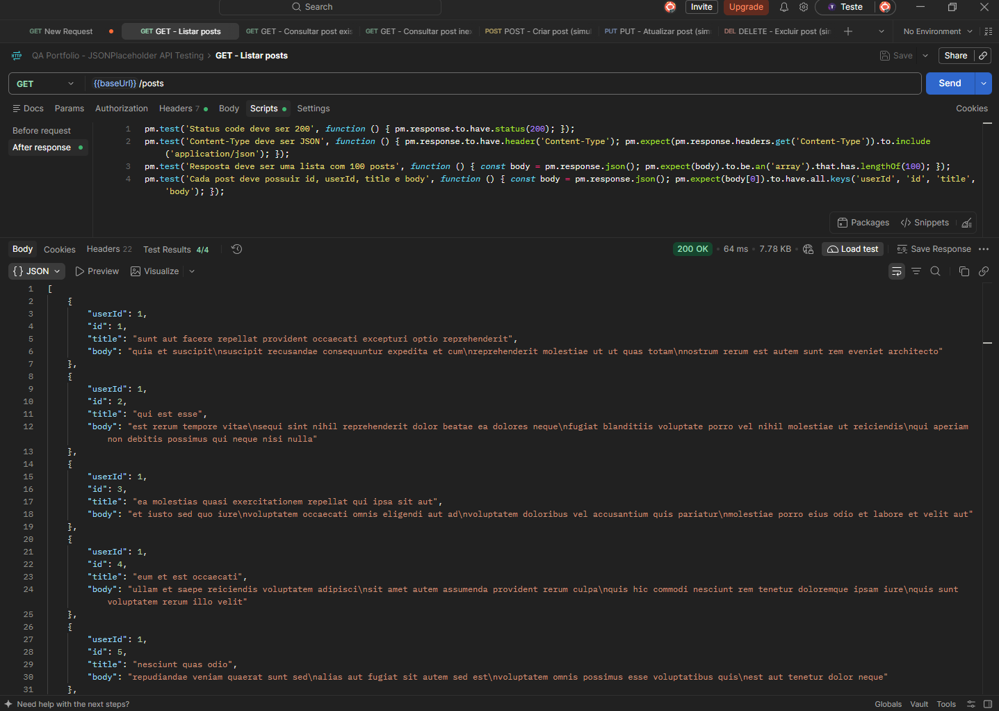
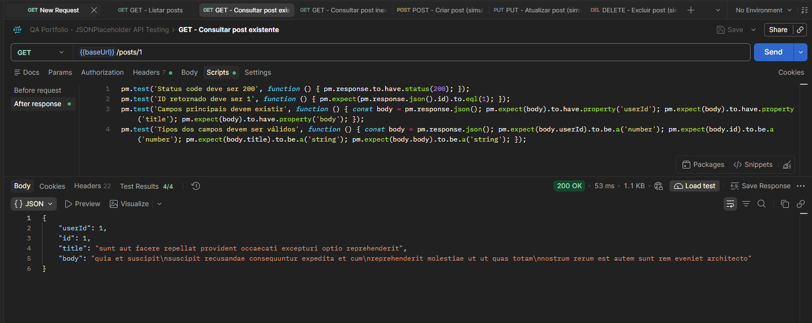
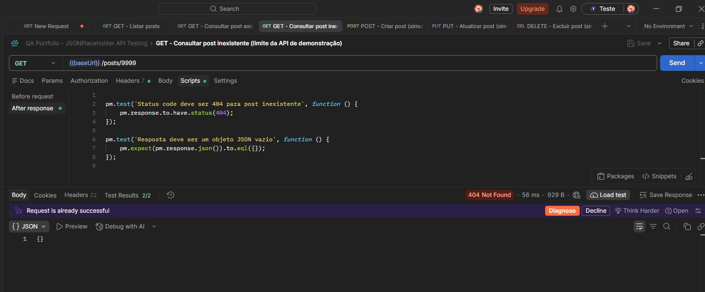
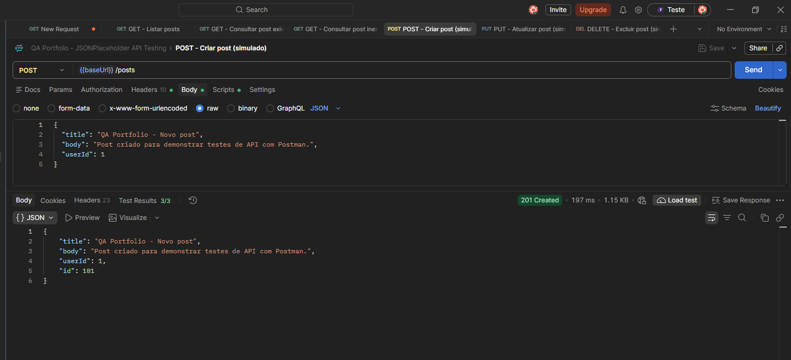
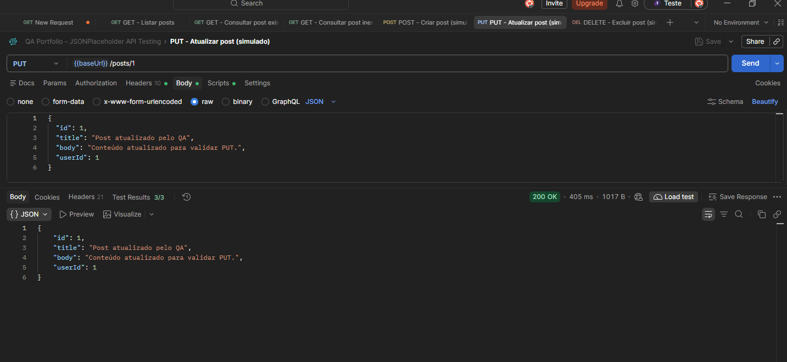
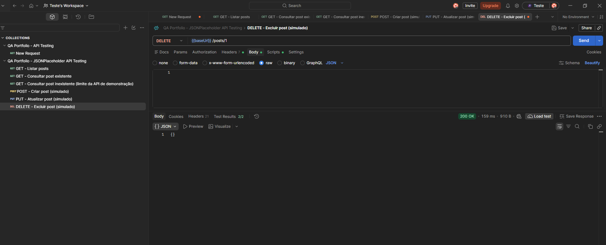

# Evidências de Testes — API Testing

Esta página reúne as evidências visuais das execuções realizadas no Postman durante os testes funcionais da API REST JSONPlaceholder, no recurso `/posts`.

## Resumo das execuções

| ID | Cenário | Método | Status HTTP | Testes automatizados |
|---|---|---|---|---:|
| CT-001 | Listar publicações | GET | 200 OK | 4/4 |
| CT-002 | Consultar publicação existente | GET | 200 OK | 4/4 |
| CT-003 | Consultar publicação inexistente | GET | 404 Not Found | 2/2 |
| CT-004 | Criar publicação (simulada) | POST | 201 Created | 3/3 |
| CT-005 | Atualizar publicação (simulada) | PUT | 200 OK | 3/3 |
| CT-006 | Excluir publicação (simulada) | DELETE | 200 OK | 2/2 |

**Resultado final:** os seis cenários foram aprovados na execução final. O CT-003 teve uma primeira execução reprovada devido a uma expectativa de status incorreta; após a análise, o critério e o script foram ajustados e o caso foi reexecutado com sucesso. O histórico está documentado em [execution-results.md](../execution-results.md).

---

## CT-001 — Listar publicações

**Objetivo:** verificar se a API retorna a lista de publicações e se a estrutura dos dados atende às validações automatizadas.

- Endpoint: `GET /posts`
- Resultado observado: `200 OK`
- Testes automatizados: **4/4 aprovados**
- Tempo observado: 64 ms

[Visualizar arquivo original](CT-001-listar-posts.png)

---

## CT-002 — Consultar publicação existente

**Objetivo:** consultar uma publicação pelo identificador e validar o status, os campos principais e seus tipos.

- Endpoint: `GET /posts/1`
- Resultado observado: `200 OK`
- Testes automatizados: **4/4 aprovados**
- Tempo observado: 53 ms

[Visualizar arquivo original](CT-002-consultar-post.png)

---

## CT-003 — Consultar publicação inexistente

**Objetivo:** verificar a resposta da API ao consultar um identificador inexistente.

- Endpoint: `GET /posts/9999`
- Resultado observado: `404 Not Found`
- Corpo retornado: objeto JSON vazio (`{}`)
- Testes automatizados: **2/2 aprovados após correção do critério**
- Tempo observado na reexecução: 56 ms

[Visualizar arquivo original](CT-003-post-inexistente.png)

---

## CT-004 — Criar publicação (POST)

**Objetivo:** enviar um payload JSON e validar o status de criação e os dados retornados.

- Endpoint: `POST /posts`
- Resultado observado: `201 Created`
- Testes automatizados: **3/3 aprovados**
- ID retornado: 101
- Tempo observado: 197 ms

[Visualizar arquivo original](CT-004-criar-post.png)

---

## CT-005 — Atualizar publicação (PUT)

**Objetivo:** enviar dados de atualização para uma publicação existente e validar os valores retornados.

- Endpoint: `PUT /posts/1`
- Resultado observado: `200 OK`
- Testes automatizados: **3/3 aprovados**
- Tempo observado: 405 ms

[Visualizar arquivo original](CT-005-atualizar-post.png)

---

## CT-006 — Excluir publicação (DELETE)

**Objetivo:** executar a operação de exclusão simulada e validar o status e o corpo da resposta.

- Endpoint: `DELETE /posts/1`
- Resultado observado: `200 OK`
- Corpo retornado: objeto JSON vazio (`{}`)
- Testes automatizados: **2/2 aprovados**
- Tempo observado: 159 ms

[Visualizar arquivo original](CT-006-excluir-post.png)

---

## Ferramentas e observações

- **Ferramenta de execução:** Postman
- **API utilizada:** JSONPlaceholder
- **Automação das validações:** JavaScript nos scripts do Postman
- Os tempos apresentados são observações das execuções registradas, não representam um SLA nem um teste de desempenho.
- As operações POST, PUT e DELETE do JSONPlaceholder são simuladas; as alterações não são persistidas permanentemente no servidor.

## Documentação relacionada

- [README do projeto](../README.md)
- [Requisitos](../requirements.md)
- [Casos de teste](../test-cases.md)
- [Histórico de execução](../execution-results.md)
- [Relatório final](../final-report.md)
- [Coleção Postman](../collection/api-testing.postman_collection.json)
